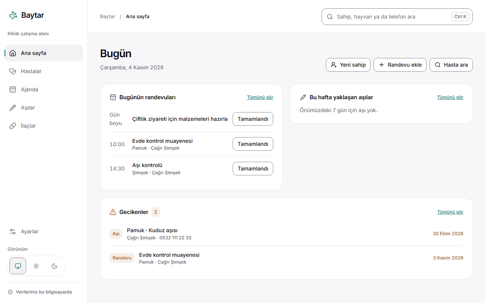
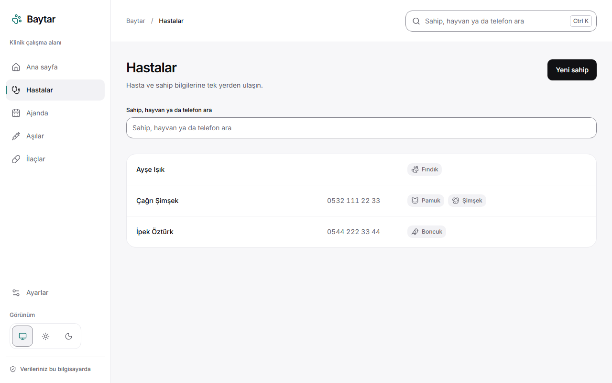
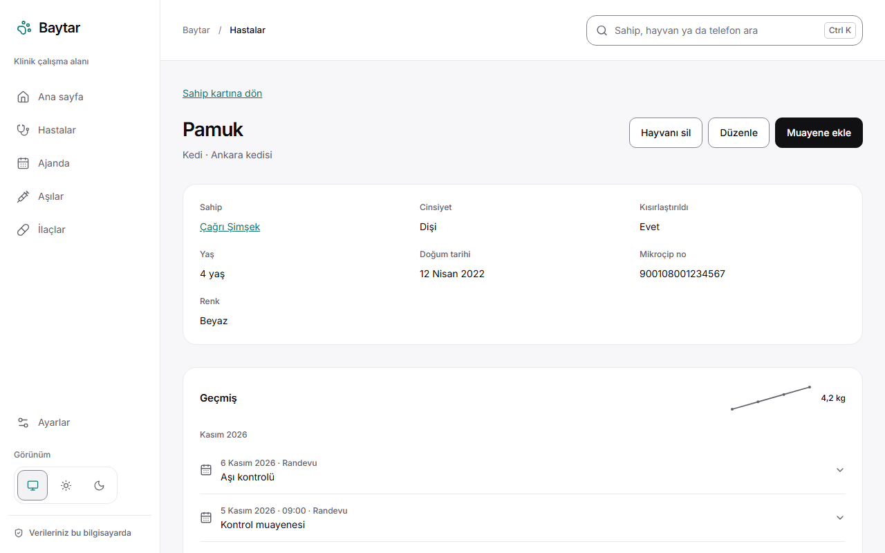
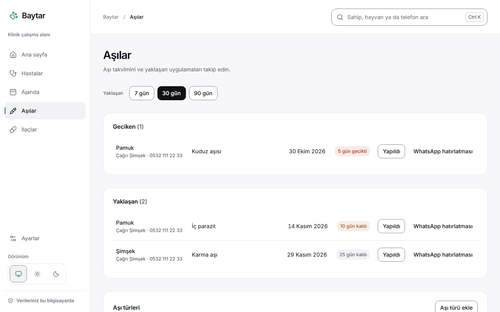
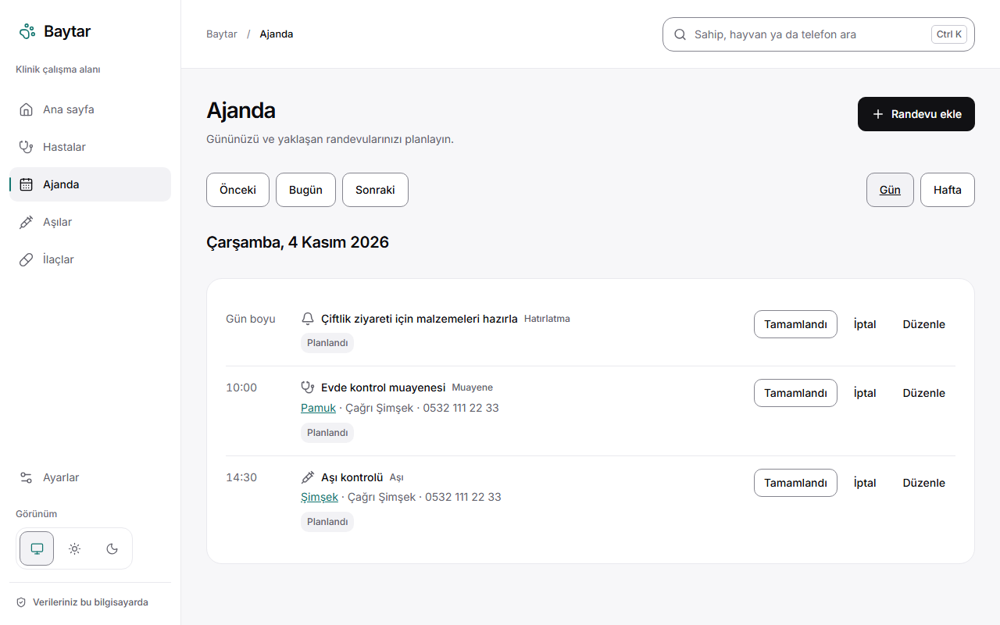
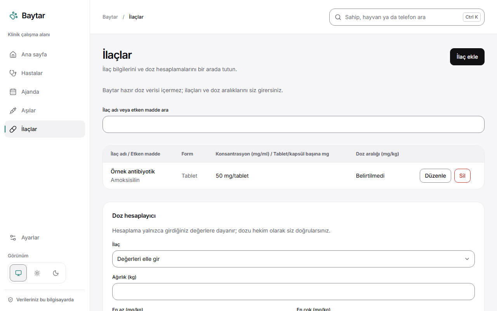
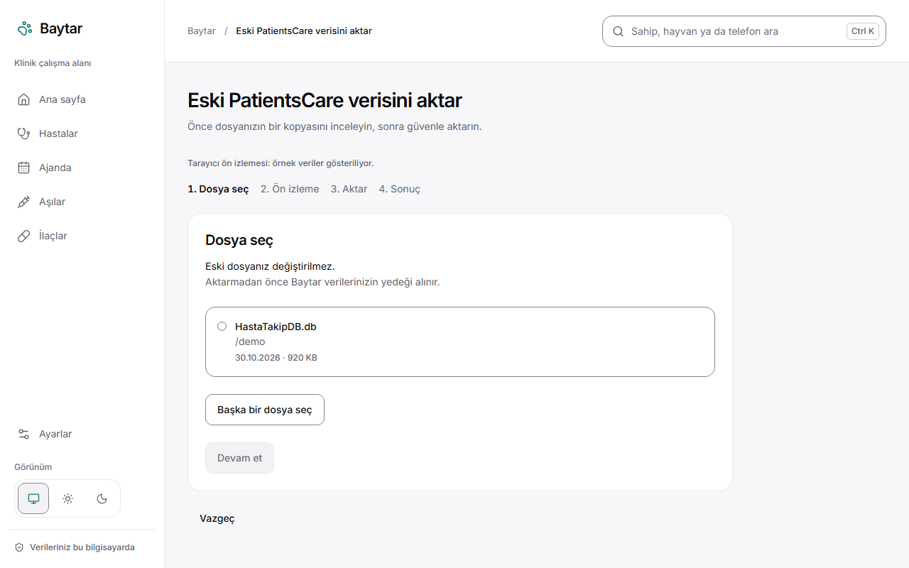

# Baytar

[](https://github.com/muhammedalikutbay/baytar/actions/workflows/ci.yml)

Free, offline veterinary practice software for independent veterinarians. Keep owners, patients, visits, vaccinations, medications and appointments on your own computer.

<picture>
  <source media="(prefers-color-scheme: dark)" srcset="docs/screenshots/home-dark.png">
  <source media="(prefers-color-scheme: light)" srcset="docs/screenshots/home-light.png">
  
</picture>

## Why Baytar

Baytar began as a project for a relative who works as a freelance veterinarian without a clinic. Existing Turkish tools are cloud-based and paid. Baytar is free, works offline and keeps practice data on the veterinarian's own computer. *Baytar* is the Ottoman Turkish word for veterinarian.

## Features

- Owners and patients, with search that ignores Turkish letter case and accents.
- Visit records with prescriptions and weight history.
- Vaccination tracking with due and overdue lists and WhatsApp reminder links.
- A medication list you maintain, with a dose calculator for arithmetic only; no dose data is bundled.
- An agenda with recurring reminders.
- Automatic daily backups, restore and export.
- Lossless import from PatientsCare.
- Light and dark themes.
- Automatic updates from GitHub Releases, with a backup taken before every update (you can turn the check off).

## Screenshots

| Light theme | Light theme |
|---|---|
| <br>Search owners and patients. | <br>Patient details, visit history and weight history. |
| <br>Upcoming and overdue vaccinations. | <br>Appointments and reminders. |
| <br>Your medication list and dose calculator. | <br>Review the import before confirming it. |

Dark theme is available throughout the app; the home screen above follows your system color preference.

## Download and install

Download the latest installer from [GitHub Releases](https://github.com/muhammedalikutbay/baytar/releases).

- **Windows:** Run the per-user `*-setup.exe`; administrator access is not required. Unsigned builds may show Microsoft SmartScreen. Select **More info**, then **Run anyway** if you trust the release you downloaded.
- **macOS:** Open the DMG and move Baytar to Applications. For an unsigned build's first launch, right-click the app and choose **Open**.
- **Linux:** Make the AppImage executable with `chmod +x Baytar*.AppImage`, then run it; or install the `.deb` package with your distribution's package manager.

## Your data

Baytar stores its SQLite database on your computer:

- **Windows:** `%APPDATA%\com.kutbay.baytar`
- **macOS:** `~/Library/Application Support/com.kutbay.baytar`
- **Linux:** `~/.local/share/com.kutbay.baytar`

Backups are in the `backups` folder inside that directory. The automatic retention policy keeps daily backups for the 14 newest dates and one backup per week for the 8 most recent weeks. Manual and safety backups are separate from this daily-backup retention. You can create, restore and export backups in the app.

No account, no server, no telemetry; the only network call is the optional update check.

## Moving from PatientsCare

The import wizard has four steps: select the old database, review a preview, confirm the import, and inspect the result. Baytar copies and reads the source file; it never changes the old PatientsCare file. It takes a backup of the Baytar database before importing.

Known values are normalized where possible, including restoring a lost leading zero on recognized Turkish mobile numbers and parsing supported date formats. Unrecognized or malformed values are preserved in notes and reported for review. The import is designed to retain records without silently discarding unknown data.

## Development

### Prerequisites

- Rust stable and its platform toolchain.
- Node.js 24.
- Tauri 2 platform dependencies for your operating system; see the [Tauri prerequisites](https://v2.tauri.app/start/prerequisites/).

From the repository root:

```sh
cd app
npm ci
npm run tauri dev
```

In another terminal at the repository root, run Rust and frontend checks:

```sh
cargo test --workspace
cd app
npm run check
```

Run `npm run dev` in `app/` to use the browser mock without Tauri. It renders the UI with example data; Tauri-only operations are unavailable in a regular browser.

### Project layout

- `crates/baytar-core/` — domain logic, SQLite schema and migrations, repositories, backups, PatientsCare import and dose calculations.
- `crates/baytar-cli/` — development and maintenance commands.
- `app/` — SvelteKit, Svelte and TypeScript UI; `app/src-tauri/` is the desktop command layer.
- `docs/` — [documentation index](docs/README.md), [data model](docs/data-model.md), [legacy schema and import](docs/legacy-schema.md), [design language](docs/design-language.md), and [release process](docs/releasing.md).
- `tools/` — build and maintenance scripts.

See [CONTRIBUTING.md](CONTRIBUTING.md) for issues, branches, code style and data-safety rules.

### Technology and architecture

**Tauri 2, Rust, SQLite (`rusqlite` with bundled SQLite), SvelteKit static adapter, Svelte 5, TypeScript, Vite and Tailwind CSS 4.** The Rust `baytar-core` crate owns data access, schema migrations, backups and legacy import. The Tauri layer exposes desktop commands over that core; the SvelteKit frontend provides the user interface and can also run as a browser mock.

## History

Baytar started in January 2025 as PatientsCare, a Windows Forms app (tag [`v0.1-winforms`](https://github.com/muhammedalikutbay/baytar/tree/v0.1-winforms)). It was rewritten in 2026 with Tauri and Rust for Windows, macOS and Linux.

## License

Baytar is licensed under [GPL-3.0](LICENSE). PatientsCare through `v0.1-winforms` was licensed under MIT.

## Türkçe

### Baytar

Bağımsız veteriner hekimler için ücretsiz ve çevrimdışı çalışan bir muayenehane yazılımı. Sahip, hasta, muayene, aşı, ilaç ve randevu kayıtlarınızı kendi bilgisayarınızda tutun.

<picture>
  <source media="(prefers-color-scheme: dark)" srcset="docs/screenshots/home-dark.png">
  <source media="(prefers-color-scheme: light)" srcset="docs/screenshots/home-light.png">
  
</picture>

### Neden Baytar?

Baytar, kliniği olmadan serbest veteriner hekim olarak çalışan bir yakınımız için başladı. Türkiye'deki mevcut araçlar bulut tabanlı ve ücretli. Baytar ücretsizdir, çevrimdışı çalışır ve mesleki verileri veteriner hekimin kendi bilgisayarında saklar. *Baytar*, Osmanlı Türkçesinde veteriner anlamına gelir.

### Özellikler

- Türkçe harflerde büyük-küçük harf ve aksan farkını göz ardı ederek sahip ve hasta arama.
- Reçete ve kilo geçmişi içeren muayene kayıtları.
- Yaklaşan ve gecikmiş aşı listeleri ile WhatsApp hatırlatma bağlantıları.
- Kendi oluşturduğunuz ilaç listesi ve yalnızca aritmetik yapan doz hesaplayıcı; hazır doz verisi içermez.
- Tekrarlayan hatırlatmalar içeren ajanda.
- Otomatik günlük yedekleme, geri yükleme ve dışa aktarma.
- PatientsCare'den kayıpsız veri aktarımı.
- Açık ve koyu tema.
- GitHub Releases üzerinden otomatik güncelleme; her güncellemeden önce yedek alınır (denetim kapatılabilir).

### Ekran görüntüleri

| Açık tema | Açık tema |
|---|---|
| <br>Sahip ve hasta arama. | <br>Hasta bilgileri, muayene ve kilo geçmişi. |
| <br>Yaklaşan ve gecikmiş aşılar. | <br>Randevu ve hatırlatmalar. |
| <br>İlaç listeniz ve doz hesaplayıcı. | <br>Aktarımı onaylamadan önce inceleyin. |

Uygulamanın tamamında koyu tema da kullanılabilir. Yukarıdaki ana ekran, sisteminizin renk tercihine göre gösterilir.

### İndirme ve kurulum

En güncel kurulum dosyasını [GitHub Releases](https://github.com/muhammedalikutbay/baytar/releases) sayfasından indirin.

- **Windows:** Kullanıcı hesabınıza kurulum yapan `*-setup.exe` dosyasını çalıştırın; yönetici izni gerekmez. İmzalanmamış sürümlerde Microsoft SmartScreen uyarısı çıkabilir. İndirdiğiniz sürüme güveniyorsanız **More info** ve ardından **Run anyway** seçeneklerini kullanın.
- **macOS:** DMG dosyasını açıp Baytar'ı Applications klasörüne taşıyın. İmzalanmamış sürümü ilk kez açarken uygulamaya sağ tıklayıp **Open** seçin.
- **Linux:** AppImage dosyasını `chmod +x Baytar*.AppImage` komutuyla çalıştırılabilir yapıp açın veya `.deb` paketini dağıtımınızın paket yöneticisiyle kurun.

### Verileriniz

Baytar, SQLite veritabanını bilgisayarınızda saklar:

- **Windows:** `%APPDATA%\com.kutbay.baytar`
- **macOS:** `~/Library/Application Support/com.kutbay.baytar`
- **Linux:** `~/.local/share/com.kutbay.baytar`

Yedekler bu klasörün içindeki `backups` dizinindedir. Otomatik saklama politikası, en yeni 14 tarihe ait günlük yedekleri ve son 8 haftanın her biri için bir yedeği tutar. Elle alınan ve güvenlik amaçlı yedekler bu günlük yedek politikasından ayrıdır. Uygulamadan yedek oluşturabilir, geri yükleyebilir ve dışa aktarabilirsiniz.

Hesap yok, sunucu yok, telemetri yok; tek ağ bağlantısı isteğe bağlı güncelleme kontrolüdür.

### PatientsCare'den geçiş

Aktarım sihirbazı dört adımdan oluşur: eski veritabanını seçme, önizlemeyi inceleme, aktarımı onaylama ve sonucu görme. Baytar kaynak dosyanın bir kopyasını okuyup aktarır; eski PatientsCare dosyasını değiştirmez. Aktarımdan önce Baytar veritabanının yedeğini alır.

Bilinen değerler mümkün olduğunda düzeltilir; örneğin tanınan Türkiye cep telefonu numaralarına kaybolan baştaki sıfır eklenir ve desteklenen tarih biçimleri okunur. Tanınmayan veya bozuk değerler notlarda korunur ve inceleme için raporlanır. Amaç, bilinmeyen verileri sessizce silmeden kayıtları korumaktır.

### Geliştirme

#### Gereksinimler

- Rust stable ve platform araç zinciri.
- Node.js 24.
- İşletim sisteminize uygun Tauri 2 bağımlılıkları; [Tauri gereksinimlerine](https://v2.tauri.app/start/prerequisites/) bakın.

Depoyu klonladıktan sonra kök dizinde:

```sh
cd app
npm ci
npm run tauri dev
```

Başka bir terminalde, depo kökünden Rust ve arayüz kontrollerini çalıştırın:

```sh
cargo test --workspace
cd app
npm run check
```

Tauri olmadan tarayıcı örneğini çalıştırmak için `app/` dizininde `npm run dev` komutunu kullanın. Arayüz örnek verilerle açılır; Tauri gerektiren işlemler normal tarayıcıda kullanılamaz.

#### Proje yapısı

- `crates/baytar-core/` — alan mantığı, SQLite şeması ve geçişleri, depolar, yedekleme, PatientsCare aktarımı ve doz hesapları.
- `crates/baytar-cli/` — geliştirme ve bakım komutları.
- `app/` — SvelteKit, Svelte ve TypeScript arayüzü; `app/src-tauri/` masaüstü komut katmanıdır.
- `docs/` — [belge dizini](docs/README.md), [veri modeli](docs/data-model.md), [eski şema ve aktarım](docs/legacy-schema.md), [tasarım dili](docs/design-language.md) ve [sürüm yayımlama süreci](docs/releasing.md).
- `tools/` — derleme ve bakım betikleri.

Sorun bildirme, dallar, kod biçemi ve veri güvenliği için [CONTRIBUTING.md](CONTRIBUTING.md) dosyasına bakın.

#### Teknoloji ve mimari

**Tauri 2, Rust, SQLite (`rusqlite`, SQLite gömülü), SvelteKit static adapter, Svelte 5, TypeScript, Vite ve Tailwind CSS 4.** Veri erişimi, şema geçişleri, yedekler ve eski veriyi aktarma Rust `baytar-core` kasasında bulunur. Tauri katmanı bu çekirdeğin masaüstü komutlarını sunar; SvelteKit arayüzü uygulamayı görüntüler ve tarayıcı örneği olarak da çalışabilir.

### Geçmiş

Baytar, Ocak 2025'te PatientsCare adıyla bir Windows Forms uygulaması olarak başladı ([`v0.1-winforms`](https://github.com/muhammedalikutbay/baytar/tree/v0.1-winforms) etiketi). 2026'da Tauri ve Rust ile Windows, macOS ve Linux için yeniden yazıldı.

### Lisans

Baytar [GPL-3.0](LICENSE) lisanslıdır. `v0.1-winforms` sürümüne kadar PatientsCare MIT lisanslıydı.
