# Baytar

[](https://github.com/muhammedalikutbay/baytar/actions/workflows/ci.yml)
[](https://github.com/muhammedalikutbay/baytar/releases/latest)
[](LICENSE)

Free, open-source, offline practice software for independent veterinarians and small pet clinics. Patients, visits, vaccinations, stock, accounts and reminders in one desktop app for Windows, macOS and Linux. Your records stay on your own computer.

**[Download the latest version](https://github.com/muhammedalikutbay/baytar/releases/latest)** · [Türkçe](#türkçe)

<picture>
  <source media="(prefers-color-scheme: dark)" srcset="docs/screenshots/home-dark.png">
  <source media="(prefers-color-scheme: light)" srcset="docs/screenshots/home-light.png">
  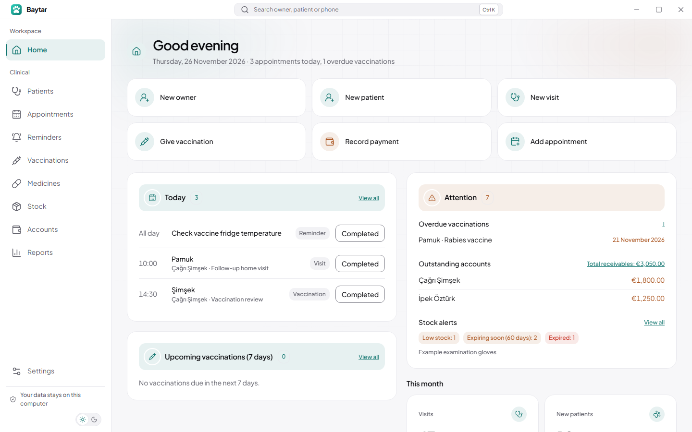
</picture>

## Why Baytar

Baytar began as a project for a relative who works as a freelance veterinarian without a clinic. Most practice software is a paid cloud subscription. Baytar is free, works without an internet connection and keeps practice data on the veterinarian's own computer, while offering the features vets expect from professional tools. *Baytar* is the Ottoman Turkish word for veterinarian.

The built-in vaccine and medicine catalog follows products sold in Turkey and can be edited freely.

## Features

- Interface in Turkish, English, German, Spanish and French; configurable currency and phone region.
- **Patients:** owners and pets (dogs, cats, birds, rabbits, rodents, ferrets, reptiles and any other animal), photos and files, allergy/behaviour alerts, Turkish-aware search. Patients are picked from an owner list that adapts to the size of the practice.
- **Validated input:** international phone numbers (+90 by default), e-mail, Turkish ID and tax numbers, microchip numbers, amounts and times.
- **Visits:** SOAP-style records with vitals (weight, temperature, heart and respiratory rate, body condition score), reusable templates, prescriptions and weight history.
- **Vaccines:** give and plan vaccinations from one page, schedules from a built-in catalog, due and overdue lists, calendar, WhatsApp reminders.
- **Built-in catalog:** common pet vaccines, medicines (brands sold in Turkey and generics) and services; every entry is editable. The dose calculator only does arithmetic on doses you confirm.
- **Accounts:** price list, charges per visit, payments, owner statements, receivables with debt age, daily cash summary.
- **Stock:** items, lots and expiry dates, first-expiring-first-out use, low-stock and expiry warnings.
- **Reminders centre:** vaccines, appointments, debts and follow-ups in one list, editable message templates, contact log.
- **Reports:** monthly visits, patients, revenue and collections, species mix, top diagnoses and medicines, vaccine coverage; CSV export that opens cleanly in Excel.
- **Documents:** printable vaccination card, prescription, visit summary and account statement with your clinic header.
- **Agenda** with recurring appointments, an optional **PIN lock**, light and dark themes.
- **Safety:** automatic daily backups, restore, a backup before every migration, import and update; lossless import from PatientsCare.
- Update check against GitHub Releases, with a backup before every update (you can turn the check off).

## Screenshots

| | |
|---|---|
| 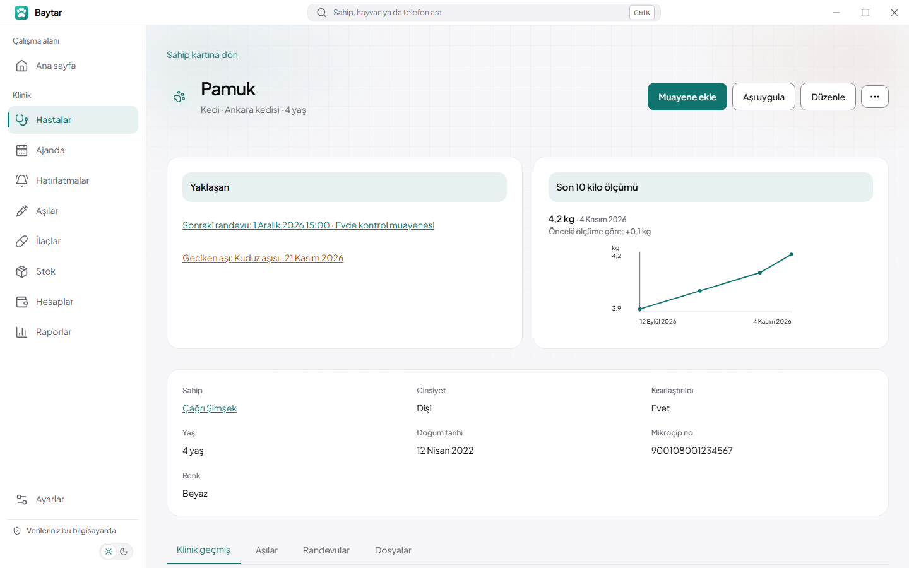<br>Patient page: upcoming items, weight trend, history, vaccines, appointments and files. | 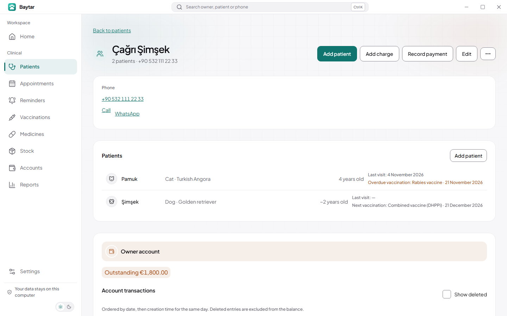<br>Owner page: pets first, contact actions, account and statement. |
| 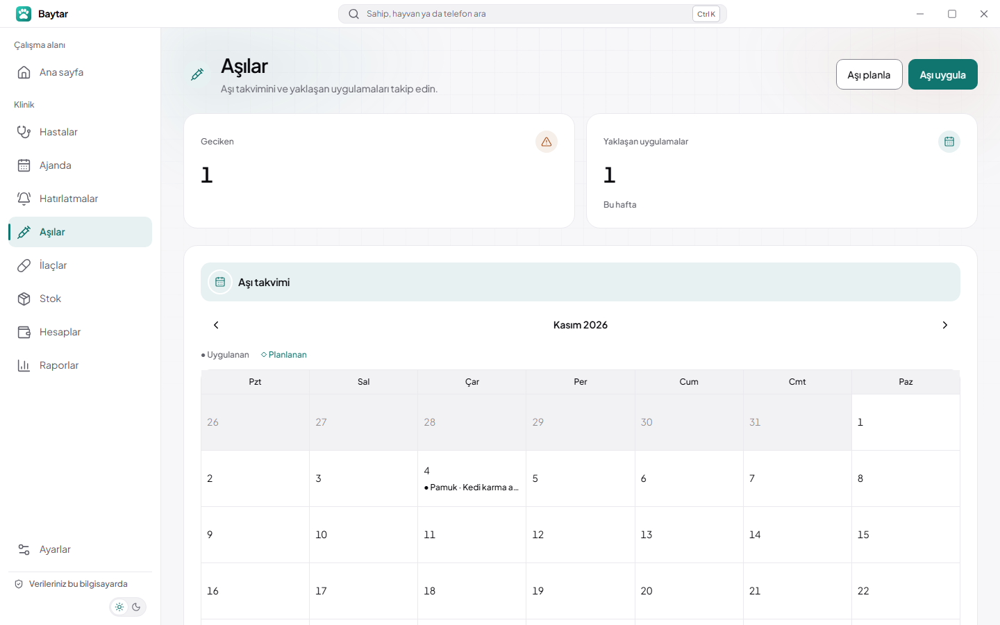<br>Give and plan vaccinations, calendar, due and overdue lists. | 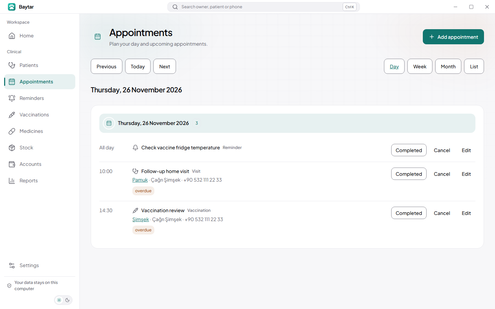<br>Day, week, month and list views. |
| 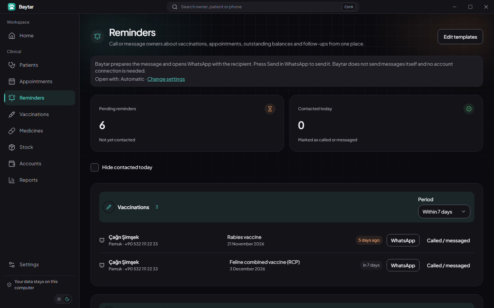<br>Reminders centre with WhatsApp messages. | 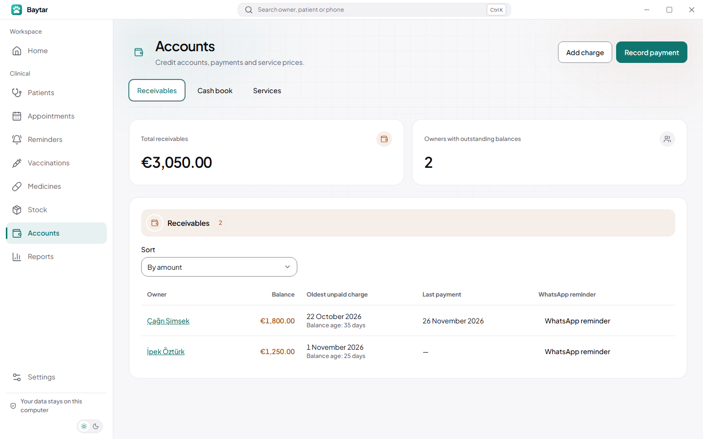<br>Receivables with debt age, cash summary, price list. |
| <br>Stock with lots, expiry dates and warnings. | <br>Monthly reports and CSV export. |

Every screen has a light and a dark theme; the app follows the system setting until you pick one. More captures are in [docs/screenshots](docs/screenshots/).

## Download and install

Download the installer for your system from the [latest release](https://github.com/muhammedalikutbay/baytar/releases/latest).

- **Windows:** Run the per-user `*-setup.exe`; administrator access is not required. Unsigned builds may show Microsoft SmartScreen. Select **More info**, then **Run anyway** if you trust the release you downloaded.
- **macOS:** Open the DMG and move Baytar to Applications. For an unsigned build's first launch, right-click the app and choose **Open**.
- **Linux:** Make the AppImage executable with `chmod +x Baytar*.AppImage`, then run it; or install the `.deb` package with your distribution's package manager.

## Your data

Baytar stores its SQLite database on your computer:

- **Windows:** `%APPDATA%\com.kutbay.baytar`
- **macOS:** `~/Library/Application Support/com.kutbay.baytar`
- **Linux:** `~/.local/share/com.kutbay.baytar`

Backups are in the `backups` folder inside that directory. The automatic retention policy keeps daily backups for the 14 newest dates and one backup per week for the 8 most recent weeks. Manual and safety backups are separate from this daily-backup retention. You can create, restore and export backups in the app.

Set the `BAYTAR_DATA_DIR` environment variable to keep the data in another folder, for example on an external drive.

No account, no server, no telemetry. The network is used only for the optional update check and when you choose to open WhatsApp.

## Moving from PatientsCare

The import wizard has four steps: select the old database, review a preview, confirm the import, and inspect the result. Baytar copies and reads the source file; it never changes the old PatientsCare file. It takes a backup of the Baytar database before importing.

Known values are normalized where possible, including converting recognized Turkish numbers to the international format (+90) and parsing supported date formats. Unrecognized or malformed values are preserved in notes and reported for review. The import is designed to retain records without silently discarding unknown data.

## Development

### Prerequisites

- Rust stable and its platform toolchain.
- Node.js 24.
- Tauri 2 platform dependencies for your operating system; see the [Tauri prerequisites](https://v2.tauri.app/start/prerequisites/).

From the repository root:

```sh
cd app
npm ci
npm run tauri dev
```

In another terminal at the repository root, run Rust and frontend checks:

```sh
cargo test --workspace
cd app
npm run check
```

Run `npm run dev` in `app/` to use the browser mock without Tauri. It renders the UI with example data; Tauri-only operations are unavailable in a regular browser.

### Project layout

- `crates/baytar-core/` — domain logic, SQLite schema and migrations, repositories, backups, PatientsCare import and dose calculations.
- `crates/baytar-cli/` — development and maintenance commands.
- `app/` — SvelteKit, Svelte and TypeScript UI; `app/src-tauri/` is the desktop command layer.
- `docs/` — [documentation index](docs/README.md), [data model](docs/data-model.md), [legacy schema and import](docs/legacy-schema.md), [design language](docs/design-language.md), and [release process](docs/releasing.md).
- `tools/` — build and maintenance scripts.

See [CONTRIBUTING.md](CONTRIBUTING.md) for issues, branches, code style and data-safety rules.

### Technology and architecture

**Tauri 2, Rust, SQLite (`rusqlite` with bundled SQLite), SvelteKit static adapter, Svelte 5, TypeScript, Vite and Tailwind CSS 4.** The Rust `baytar-core` crate owns data access, schema migrations, backups and legacy import. The Tauri layer exposes desktop commands over that core; the SvelteKit frontend provides the user interface and can also run as a browser mock.

## History

Baytar started in January 2025 as PatientsCare, a Windows Forms app (tag [`v0.1-winforms`](https://github.com/muhammedalikutbay/baytar/tree/v0.1-winforms)). It was rewritten in 2026 with Tauri and Rust for Windows, macOS and Linux and grew into a full practice tool. The maintainer planned and reviewed the rewrite; AI coding agents wrote much of the implementation. The plan is in [docs/v2-plan.md](docs/v2-plan.md) and the task history in `.beads/`. Release notes are in [CHANGELOG.md](CHANGELOG.md).

## License

Baytar is licensed under [GPL-3.0](LICENSE). PatientsCare through `v0.1-winforms` was licensed under MIT.

## Türkçe

### Baytar

Serbest çalışan veteriner hekimler ve küçük pet klinikleri için ücretsiz, açık kaynaklı ve internet olmadan çalışan muayenehane yazılımı. Hasta, muayene, aşı, stok, hesap ve hatırlatmalar Windows, macOS ve Linux'ta tek bir masaüstü uygulamasında. Kayıtlarınız kendi bilgisayarınızda kalır.

**[En güncel sürümü indirin](https://github.com/muhammedalikutbay/baytar/releases/latest)**

<picture>
  <source media="(prefers-color-scheme: dark)" srcset="docs/screenshots/tr/home-dark.png">
  <source media="(prefers-color-scheme: light)" srcset="docs/screenshots/tr/home-light.png">
  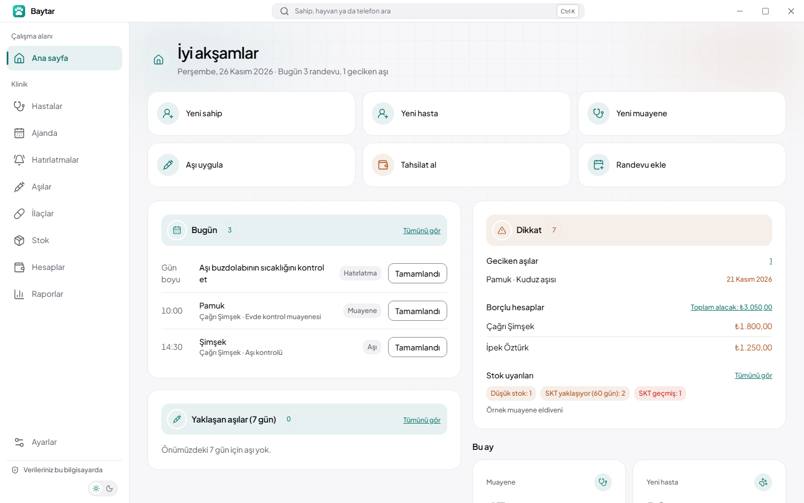
</picture>

### Neden Baytar?

Baytar, kliniği olmadan serbest veteriner hekim olarak çalışan bir yakınımız için başladı. Muayenehane yazılımlarının çoğu ücretli bulut aboneliğidir. Baytar ücretsizdir, internet olmadan çalışır ve verileri hekimin kendi bilgisayarında saklar; bunu yaparken profesyonel yazılımlardan beklenen özellikleri sunar. *Baytar*, Osmanlı Türkçesinde veteriner hekim anlamına gelir.

### Özellikler

- Türkçe, İngilizce, Almanca, İspanyolca ve Fransızca arayüz; ayarlanabilir para birimi ve telefon bölgesi.
- **Hastalar:** sahipler ve evcil hayvanlar (köpek, kedi, kuş, tavşan, kemirgen, gelincik, sürüngen ve diğer), fotoğraf ve dosyalar, alerji/davranış uyarıları, Türkçe harflere duyarlı arama. Hasta, kayıt sayısına göre uyum sağlayan sahip listesinden seçilir.
- **Doğrulamalı alanlar:** uluslararası telefon numarası (varsayılan +90), e-posta, TC kimlik ve vergi numarası, mikroçip, tutar ve saat.
- **Muayene:** SOAP düzeninde kayıt, vital bulgular (kilo, ateş, nabız, solunum, vücut kondisyonu), muayene şablonları, reçete ve kilo geçmişi.
- **Aşılar:** tek sayfadan aşı uygulama ve planlama, hazır katalogdan aşı takvimi, yaklaşan ve geciken listeler, takvim, WhatsApp hatırlatması.
- **Hazır katalog:** yaygın pet aşıları, ilaçlar (Türkiye'de satılan markalar ve jenerikler) ve hizmetler; hepsi düzenlenebilir. Doz hesaplayıcı yalnızca hekimin onayladığı değerlerle hesap yapar.
- **Hesaplar:** fiyat listesi, muayeneye ücret, tahsilat, sahip ekstresi, borç yaşıyla alacaklar, günlük kasa özeti.
- **Stok:** kalemler, parti ve son kullanma tarihleri, önce son kullanma tarihi yaklaşanı kullanma, düşük stok ve SKT uyarıları.
- **Hatırlatma merkezi:** aşı, randevu, borç ve kontroller tek listede, düzenlenebilir mesaj şablonları, iletişim kaydı.
- **Raporlar:** aylık muayene, hasta, ciro ve tahsilat, tür dağılımı, en sık tanılar ve ilaçlar, aşı kapsaması; Excel'de düzgün açılan CSV dışa aktarma.
- **Belgeler:** klinik başlığıyla yazdırılabilir aşı karnesi, reçete, muayene özeti ve hesap ekstresi.
- Tekrarlayan randevulu **ajanda**, isteğe bağlı **PIN kilidi**, açık ve koyu tema.
- **Güvenlik:** otomatik günlük yedek, geri yükleme; her migrasyon, içe aktarma ve güncellemeden önce yedek; PatientsCare'den kayıpsız aktarım.
- GitHub Releases üzerinden güncelleme denetimi; her güncellemeden önce yedek alınır (denetim kapatılabilir).

### Ekran görüntüleri

| | |
|---|---|
| <br>Hasta sayfası: yaklaşanlar, kilo eğrisi, geçmiş, aşılar, randevular ve dosyalar. | 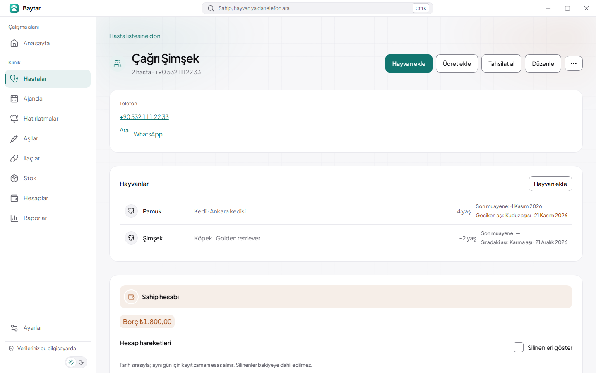<br>Sahip sayfası: önce hayvanlar, iletişim, hesap ve ekstre. |
| <br>Aşı uygulama ve planlama, takvim, yaklaşan ve geciken aşılar. | 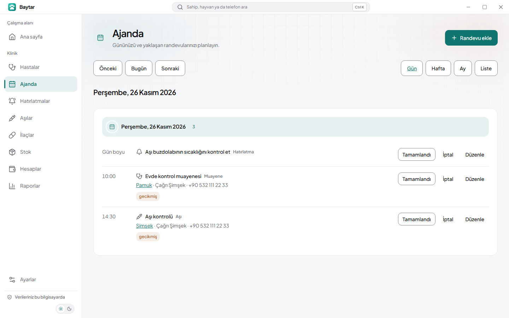<br>Gün, hafta, ay ve liste görünümleri. |
| 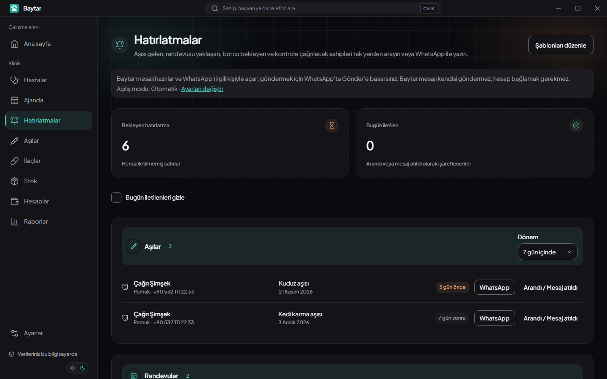<br>WhatsApp mesajlarıyla hatırlatma merkezi. | 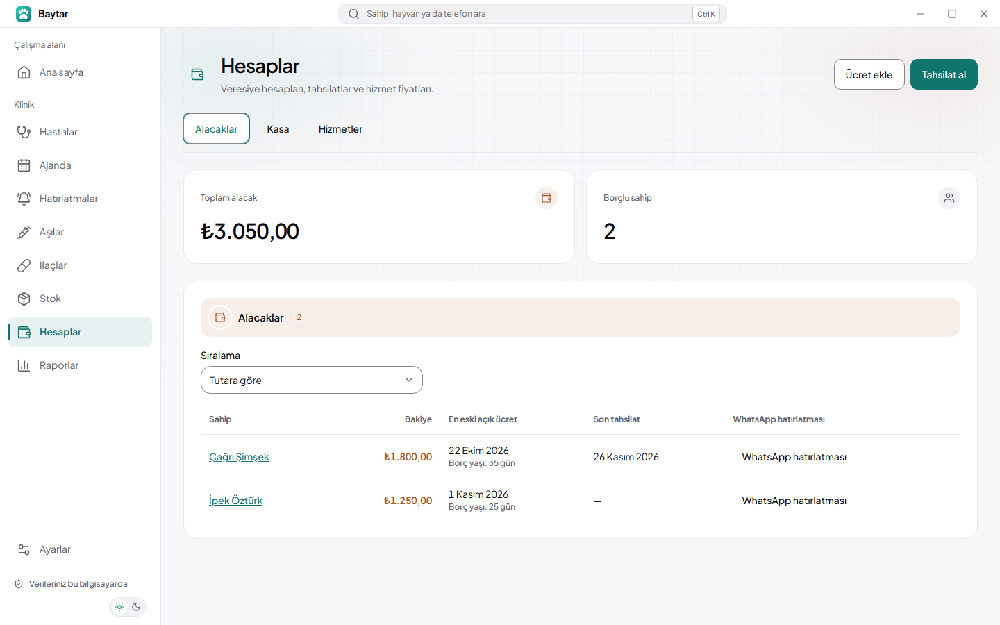<br>Borç yaşıyla alacaklar, kasa ve fiyat listesi. |
| 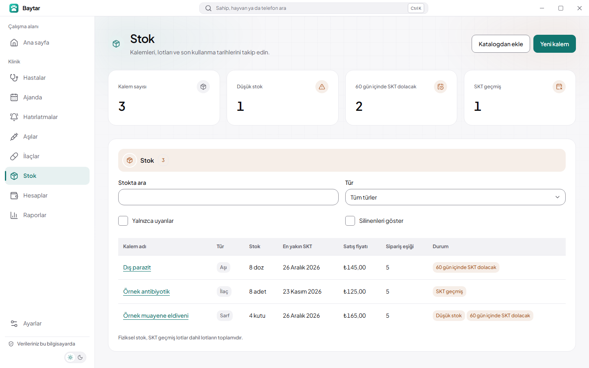<br>Parti ve son kullanma tarihli stok, uyarılar. | 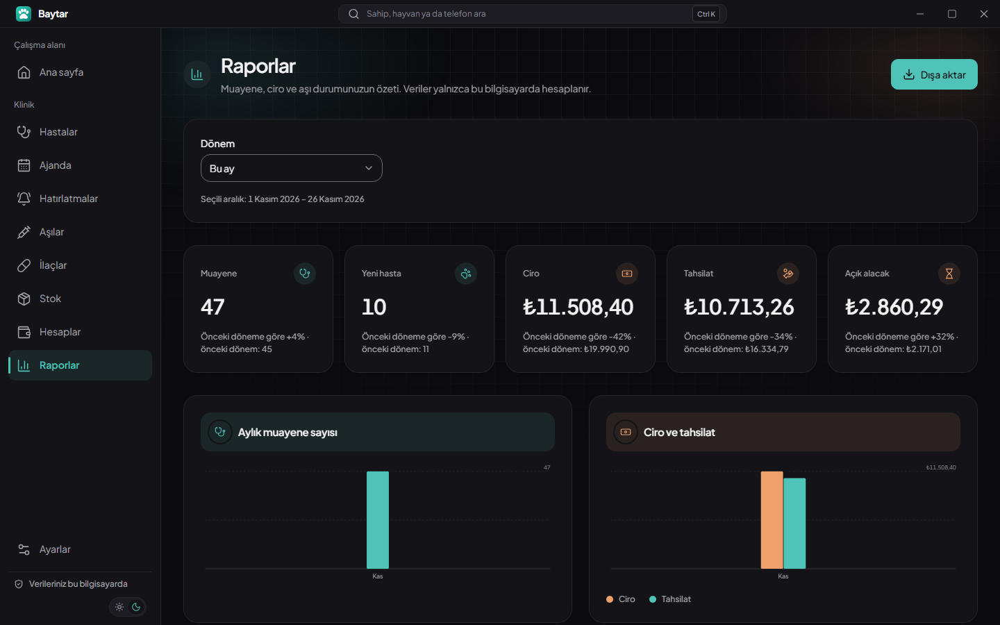<br>Aylık raporlar ve CSV dışa aktarma. |

Her ekranın açık ve koyu teması var; uygulama siz seçene kadar sistem ayarını izler. Diğer görüntüler [docs/screenshots](docs/screenshots/tr/) klasöründe.

### İndirme ve kurulum

Sisteminize uygun kurulum dosyasını [en güncel sürüm](https://github.com/muhammedalikutbay/baytar/releases/latest) sayfasından indirin.

- **Windows:** Kullanıcı hesabınıza kurulum yapan `*-setup.exe` dosyasını çalıştırın; yönetici izni gerekmez. İmzalanmamış sürümlerde Microsoft SmartScreen uyarısı çıkabilir. İndirdiğiniz sürüme güveniyorsanız **More info** ve ardından **Run anyway** seçeneklerini kullanın.
- **macOS:** DMG dosyasını açıp Baytar'ı Applications klasörüne taşıyın. İmzalanmamış sürümü ilk kez açarken uygulamaya sağ tıklayıp **Open** seçin.
- **Linux:** AppImage dosyasını `chmod +x Baytar*.AppImage` komutuyla çalıştırılabilir yapıp açın veya `.deb` paketini dağıtımınızın paket yöneticisiyle kurun.

### Verileriniz

Baytar, SQLite veritabanını bilgisayarınızda saklar:

- **Windows:** `%APPDATA%\com.kutbay.baytar`
- **macOS:** `~/Library/Application Support/com.kutbay.baytar`
- **Linux:** `~/.local/share/com.kutbay.baytar`

Yedekler bu klasörün içindeki `backups` dizinindedir. Otomatik saklama politikası, en yeni 14 tarihe ait günlük yedekleri ve son 8 haftanın her biri için bir yedeği tutar. Elle alınan ve güvenlik amaçlı yedekler bu günlük yedek politikasından ayrıdır. Uygulamadan yedek oluşturabilir, geri yükleyebilir ve dışa aktarabilirsiniz.

Verileri başka bir klasörde, örneğin harici diskte tutmak için `BAYTAR_DATA_DIR` ortam değişkenini ayarlayın.

Hesap yok, sunucu yok, telemetri yok. İnternet yalnızca isteğe bağlı güncelleme denetiminde ve WhatsApp'ı açtığınızda kullanılır.

### PatientsCare'den geçiş

Aktarım sihirbazı dört adımdan oluşur: eski veritabanını seçme, önizlemeyi inceleme, aktarımı onaylama ve sonucu görme. Baytar kaynak dosyanın bir kopyasını okuyup aktarır; eski PatientsCare dosyasını değiştirmez. Aktarımdan önce Baytar veritabanının yedeğini alır.

Bilinen değerler mümkün olduğunda düzeltilir; örneğin tanınan Türkiye numaraları uluslararası biçime (+90) çevrilir ve desteklenen tarih biçimleri okunur. Tanınmayan veya bozuk değerler notlarda korunur ve inceleme için raporlanır. Amaç, bilinmeyen verileri sessizce silmeden kayıtları korumaktır.

### Geliştirme

#### Gereksinimler

- Rust stable ve platform araç zinciri.
- Node.js 24.
- İşletim sisteminize uygun Tauri 2 bağımlılıkları; [Tauri gereksinimlerine](https://v2.tauri.app/start/prerequisites/) bakın.

Depoyu klonladıktan sonra kök dizinde:

```sh
cd app
npm ci
npm run tauri dev
```

Başka bir terminalde, depo kökünden Rust ve arayüz kontrollerini çalıştırın:

```sh
cargo test --workspace
cd app
npm run check
```

Tauri olmadan tarayıcı örneğini çalıştırmak için `app/` dizininde `npm run dev` komutunu kullanın. Arayüz örnek verilerle açılır; Tauri gerektiren işlemler normal tarayıcıda kullanılamaz.

#### Proje yapısı

- `crates/baytar-core/` — alan mantığı, SQLite şeması ve geçişleri, depolar, yedekleme, PatientsCare aktarımı ve doz hesapları.
- `crates/baytar-cli/` — geliştirme ve bakım komutları.
- `app/` — SvelteKit, Svelte ve TypeScript arayüzü; `app/src-tauri/` masaüstü komut katmanıdır.
- `docs/` — [belge dizini](docs/README.md), [veri modeli](docs/data-model.md), [eski şema ve aktarım](docs/legacy-schema.md), [tasarım dili](docs/design-language.md) ve [sürüm yayımlama süreci](docs/releasing.md).
- `tools/` — derleme ve bakım betikleri.

Sorun bildirme, dallar, kod biçemi ve veri güvenliği için [CONTRIBUTING.md](CONTRIBUTING.md) dosyasına bakın.

#### Teknoloji ve mimari

**Tauri 2, Rust, SQLite (`rusqlite`, SQLite gömülü), SvelteKit static adapter, Svelte 5, TypeScript, Vite ve Tailwind CSS 4.** Veri erişimi, şema geçişleri, yedekler ve eski veriyi aktarma Rust `baytar-core` kasasında bulunur. Tauri katmanı bu çekirdeğin masaüstü komutlarını sunar; SvelteKit arayüzü uygulamayı görüntüler ve tarayıcı örneği olarak da çalışabilir.

### Geçmiş

Baytar, Ocak 2025'te PatientsCare adıyla bir Windows Forms uygulaması olarak başladı ([`v0.1-winforms`](https://github.com/muhammedalikutbay/baytar/tree/v0.1-winforms) etiketi). 2026'da Tauri ve Rust ile Windows, macOS ve Linux için yeniden yazıldı ve kapsamlı bir muayenehane aracına dönüştü. Yeniden yazımı geliştirici planlayıp denetledi; uygulamanın büyük kısmını yapay zekâ kodlama ajanları yazdı. Plan [docs/v2-plan.md](docs/v2-plan.md), görev geçmişi `.beads/` klasöründe. Sürüm notları [CHANGELOG.md](CHANGELOG.md) dosyasında.

### Lisans

Baytar [GPL-3.0](LICENSE) lisanslıdır. `v0.1-winforms` sürümüne kadar PatientsCare MIT lisanslıydı.
